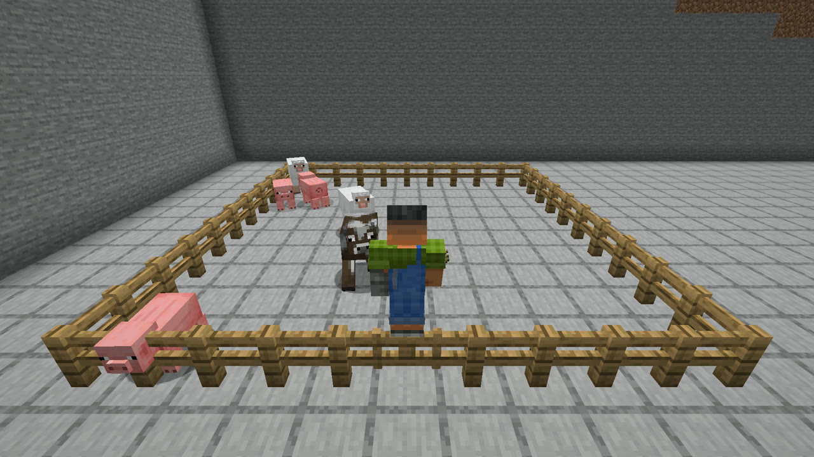
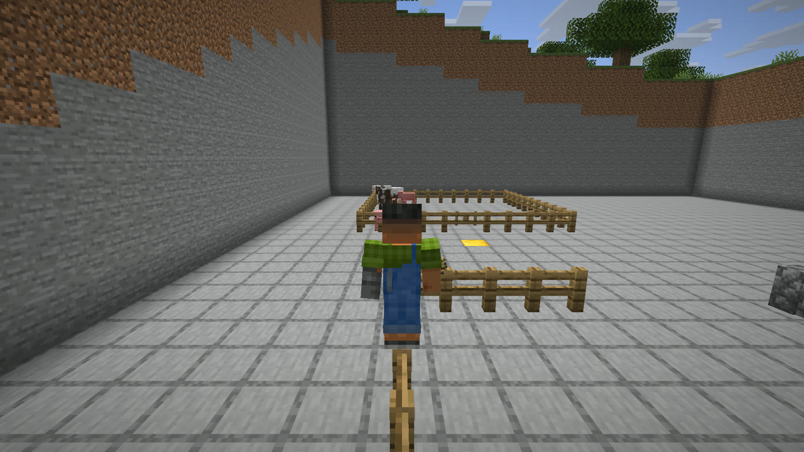
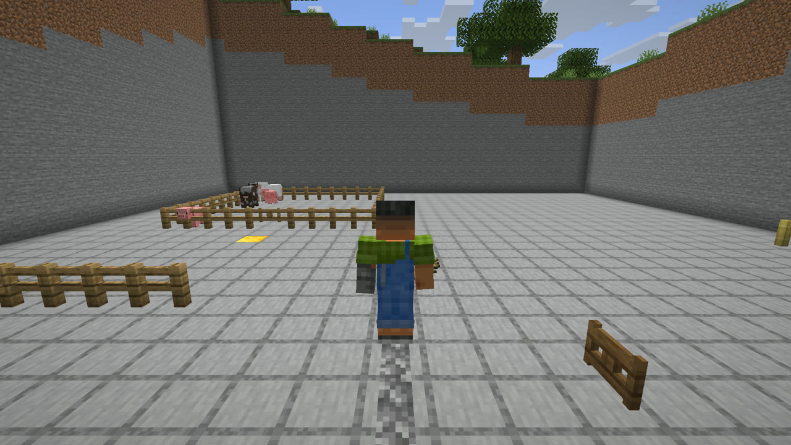

<h1 align="center">Fence Perch</h1>

  <strong>Hop onto the fence. Skip the gate.</strong> 
  A native Horizon mod: jump onto fences, walls and closed fence gates from a standstill, stand on top, step off either side.

  
  
  

  <a href="https://github.com/AyanoKaito/horizon-fence-perch/releases/tag/v1.0.0"><strong>Download</strong></a> &middot;
  <a href="docs/installation.md">Installation</a> &middot;
  <a href="VALIDATION.md">Validation</a>

  Last updated and checked: <strong>November 8, 2026</strong>, on Horizon Nightly 2026-11-07 (<code>2ebf00a</code>).

---

  

## What it does

- Walk up to a fence, wall or **closed** fence gate and jump while stepping forward: you land on top, even without a run-up.
- Stand there, walk along a connected line, then step off on either side.
- Gates stay closed, so animals stay in the pen while you climb in and out.

  
  

## How it works

For the player only, supported barriers collide like a one-block-high block instead of one and a half blocks. Your jump is not stronger: a 1.5-block ledge stays out of reach, and a low ceiling still blocks you. On top of a barrier you stand half a block lower than on a full post.

Animals and other mobs keep full-height barriers. Open gates, other blocks and every other movement rule are unchanged.

Supported blocks: vanilla blocks whose IDs end in `_fence`, `_wall` or `_fence_gate` (gates only while closed). Automated checks used oak fences, cobblestone walls and oak fence gates; spruce, nether brick and bamboo fences, mud brick walls and birch and spruce gates were checked by hand.

## Multiplayer

The host's server checks movement with the same barrier shape, so the mod works in single-player and on LAN games hosted with it. Every player needs the mod. Joining a world or server without it is not supported, and dedicated servers are not supported. See [installation](docs/installation.md).

## Compatibility

Version 1.0.0 is pinned to Horizon Nightly 2026-11-07 (`2ebf00a0281c592f79191e76fce0e7d522c6f425`) and was tested there in single-player and LAN host/guest games. Auto-jump, swimming, mounted movement and other native mods were not tested. Details: [VALIDATION.md](VALIDATION.md).

## Documentation

- [Installation](docs/installation.md): download, signature check, launcher.
- [Validation](VALIDATION.md): checks run for each version.
- [Decisions](docs/decisions.md) and [concept](docs/concept.md): approved behaviour and scope.
- [Research](docs/research/): Horizon movement and collision notes.

## Project

- Mod ID: `fence_perch`.
- Original implementation; no third-party mod code has been inspected or used.
- Developed with AI assistance under human direction.
- License: [MIT](LICENSE).
